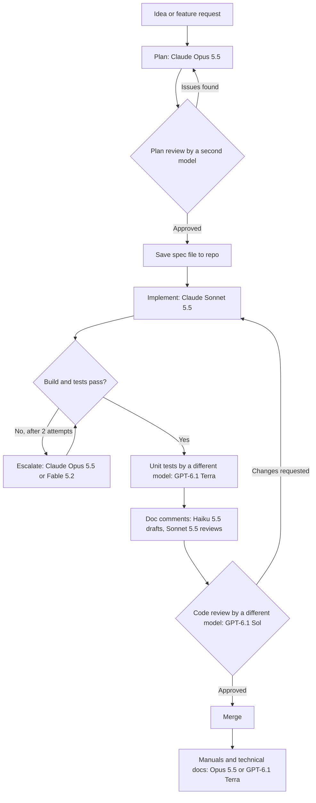
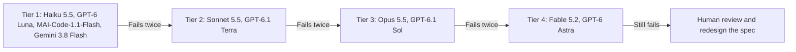

<div align="center">

  

   <br>

  <h1>Workflow</h1>

</div>

## 1. Principles

| # | Principle | Why it matters |
|---|---|---|
| 1 | **The compiler and tests decide, not the model.** | A model's confidence is not evidence. Builds, tests, and analyzers are cheap and objective. |
| 2 | **Start cheap, escalate on failure.** | Most tasks do not need the most expensive model. Escalate only after a real failure. |
| 3 | **Plan once, implement many times.** | A written spec lets cheaper models implement without long, costly conversations. |
| 4 | **Different model reviews the work.** | Models share blind spots. A second model catches errors the first one repeats. |
| 5 | **Keep context small and fresh.** | Long sessions cost more and drift. Start a new session for each task. |

---

## 2. Workflow overview



---

## 3. Phase by phase

### 3.1 Planning and design

| Item | Recommendation |
|---|---|
| **Primary model** | Claude Opus 5.5 |
| **Escalate to** | Claude Fable 5.2 for architecture with many unknowns or cross-cutting risk |
| **Reviewer** | GPT-6.1 Sol (different vendor, catches different gaps) |
| **Output** | A spec file in the repo (see Section 9) |
| **Gate** | Reviewer lists no blocking issues, and the spec includes acceptance criteria |

**What the plan must include:**
- Problem statement and non-goals
- Affected projects, namespaces, and public APIs
- Target frameworks (.NET 10, .NET Framework 4.8, or both)
- Data and dependency changes
- Acceptance criteria written as testable statements
- Risks and open questions

### 3.2 Implementation

| Item | Recommendation |
|---|---|
| **Primary model** | Claude Sonnet 5.5 for features that touch one to a few files |
| **Use Opus 5.5 instead** | Changes that span many files or require design judgment |
| **Alternative** | GPT-6.1 Sol for implementation when Claude is unavailable or when you want a second source |
| **Input** | The spec file and only the relevant source files |
| **Gate** | `dotnet build` with warnings treated as errors, and the new tests pass |

### 3.3 Refactoring

Split refactoring into two kinds, because they need different models:

| Kind | Examples | Primary model | Why |
|---|---|---|---|
| **Mechanical** | Rename, extract method, move file, update usings, apply an analyzer fix | Claude Haiku 5.5 or GPT-6 Luna | Low judgment, high volume; the compiler verifies the result |
| **Design-level** | Split a god class, introduce an abstraction, change a data flow | Claude Opus 5.5 | Needs reasoning about trade-offs and side effects |

**Refactoring rule:** Never change behavior and structure in the same commit. Run the tests before and after each refactoring step.

### 3.4 Unit tests

| Item | Recommendation |
|---|---|
| **Primary model** | GPT-6.1 Terra |
| **Why a different model than the implementer** | Tests written by the same model that wrote the code tend to encode the same wrong assumptions. |
| **Alternative** | Claude Sonnet 5.5 when the implementer was GPT-based |
| **Input** | The spec's acceptance criteria and the public API, not the private implementation |
| **Gate** | Tests pass, and mutation testing (for example, Stryker.NET) shows the tests catch injected faults |

**Test rules to give the model:**
- One behavior per test, with a name that states the behavior
- Test public behavior, not private details
- Cover edge cases: null, empty, boundary values, and exceptions
- For .NET Framework 4.8 code, use the same test framework version the project already uses

### 3.5 XML documentation and code comments

| Item | Recommendation |
|---|---|
| **Drafting** | Claude Haiku 5.5 for bulk generation across many public members |
| **Review** | Claude Sonnet 5.5 checks accuracy against the code |
| **Gate** | Build with `CS1591` (missing XML comment) enabled for public APIs. Compiler warnings for malformed XML must be zero. |

**Comment rules:**
- XML `<summary>` describes *what* and *why*, not the implementation
- Document parameters, return values, and exceptions that callers can actually receive
- Inline comments explain *why*. Code already says *what*.
- Never restate the method name in the summary
- Remove comments that drift from the code. Stale comments are worse than none.

**Efficiency tip:** Use Haiku 5.5 with batch processing for a whole-repository pass. Batch jobs are not interactive and cost less. Verify the output with a sample review.

### 3.6 Technical documentation and user manuals

| Item | Recommendation |
|---|---|
| **Primary model** | Claude Opus 5.5 for long manuals and architecture documents |
| **Alternative** | GPT-6.1 Terra for shorter how-to guides and reference pages |
| **Input** | The spec, the public API surface, and a short style guide |
| **Gate** | A reader who did not write the feature can follow the steps. Code samples compile. |

**Documentation rules:**
- Code samples must come from a real build, not a model's memory. Compile them in a test project.
- Name versions explicitly (for example, "Requires .NET 10") so readers on .NET Framework 4.8 are not misled.
- Keep one source of truth. Generate reference pages from XML comments where possible.

### 3.7 Code review

| Item | Recommendation |
|---|---|
| **Reviewer** | GPT-6.1 Sol or Gemini 3.8 Flash for large diffs |
| **Rule** | Reviewer is never the model that wrote the change |
| **Input** | The diff, the spec, and the failing or passing test output |
| **Focus** | Correctness, edge cases, concurrency, security, public API changes, and breaking behavior |
| **Gate** | No open blocking comments. A human reads any change to security code, data access, or public APIs. |

**Why Gemini 3.8 Flash for large diffs:** Its 1M-token context can hold an entire multi-file diff with supporting code, reducing the need to chunk the review.

### 3.8 Repository hygiene

| Item | Recommendation |
|---|---|
| **Primary model** | GPT-6.1 Terra for scripts and configuration |
| **Alternative** | Claude Haiku 5.5 for simple, repetitive config changes |
| **Tasks** | `.editorconfig`, analyzer settings, `.gitignore`, CI pipeline files, folder structure, branch and commit conventions |
| **Gate** | CI passes on a clean clone. Formatting check reports no changes. |

### 3.9 Migrating .NET Framework 4.8 to .NET 10

Migration is the most expensive phase, so it benefits most from careful model choice.

| Step | Primary model | Notes |
|---|---|---|
| Inventory and dependency analysis | Claude Opus 5.5 | Identify incompatible APIs and packages |
| Migration plan per project | Claude Opus 5.5, reviewed by GPT-6.1 Sol | Order projects by dependency; plan a compatibility layer if needed |
| Mechanical project file and namespace changes | Claude Haiku 5.5 | The compiler reports each error |
| Fixing individual API replacements | Claude Sonnet 5.5 | Verify each change with tests |
| Hard cases (WCF, Windows-only APIs, reflection) | Claude Fable 5.2 | Escalate after two failed attempts |
| Legacy code in maintenance mode | MAI-Code-1.1-Flash | Reported strength in .NET; cheap for quick fixes, but verify output |

**Migration rule:** Migrate one project at a time. Each project must build and pass its tests before the next one starts.

### 3.10 Vibe-coding experiments

| Item | Recommendation |
|---|---|
| **Primary model** | Gemini 3.8 Flash or MAI-Code-1.1-Flash |
| **Long context explorations** | Kimi K3 |
| **Budget** | Set a spending cap per experiment |
| **Rule** | Experiments live in a separate repository or branch. Nothing moves to production code without going through Sections 3.1 to 3.7. |

---

## 4. Model assignment matrix

| Task | Primary | Cheaper option | Escalate to | Reviewer or check |
|---|---|---|---|---|
| Plan or design | Claude Opus 5.5 | GPT-6.1 Sol | Claude Fable 5.2 | GPT-6.1 Sol |
| Implement a feature (small) | Claude Sonnet 5.5 | GPT-6.1 Terra | Claude Opus 5.5 | Tests and build |
| Implement a feature (large) | Claude Opus 5.5 | Claude Sonnet 5.5 | Claude Fable 5.2 | GPT-6.1 Sol |
| Mechanical refactor | Claude Haiku 5.5 | GPT-6 Luna | Claude Sonnet 5.5 | Compiler |
| Design refactor | Claude Opus 5.5 | Claude Sonnet 5.5 | Claude Fable 5.2 | Tests and review |
| Unit tests | GPT-6.1 Terra | Claude Sonnet 5.5 | GPT-6.1 Sol | Mutation testing |
| XML docs (bulk) | Claude Haiku 5.5 | GPT-6 Luna | Claude Sonnet 5.5 | `CS1591` build check |
| Code comments | Claude Sonnet 5.5 | Claude Haiku 5.5 | Claude Opus 5.5 | Human review |
| User manual | Claude Opus 5.5 | GPT-6.1 Terra | GPT-6.1 Sol | Compile samples |
| Code review | GPT-6.1 Sol | Gemini 3.8 Flash | Claude Opus 5.5 | Human for risky code |
| Repo or CI config | GPT-6.1 Terra | Claude Haiku 5.5 | Claude Sonnet 5.5 | CI on clean clone |
| .NET Framework migration plan | Claude Opus 5.5 | GPT-6.1 Sol | Claude Fable 5.2 | Second model review |
| Quick legacy fix | MAI-Code-1.1-Flash | Gemini 3.8 Flash | Claude Sonnet 5.5 | Tests |
| Experiment | Gemini 3.8 Flash | MAI-Code-1.1-Flash | Kimi K3 | Spending cap |
| Classification or routing (bots, tools) | Claude Haiku 5.5 | GPT-6 Luna | Claude Sonnet 5.5 | Spot checks |

**Models not used in this workflow:**
- **GPT-5.3-Codex and GPT-5.4 nano** are deprecated and shut down April 1, 2027.
- **Claude Fable 5 and 5.1** are superseded by Fable 5.2 for new work.

---

## 5. Escalation ladder

Escalate only after real failures, not because a task feels hard.



**Escalation rules:**
1. A "failure" means the build fails, a test fails, or a reviewer rejects the change.
2. Two failures at one tier triggers escalation to the next tier.
3. Before escalating, improve the input: add the failing test output, the relevant files, or a clearer spec. Escalation with a bad spec wastes money.
4. If Tier 4 fails, the problem is probably in the spec, not the model.

---

## 6. Efficiency techniques

| Technique | What to do | Where it helps |
|---|---|---|
| **Spec files as handoffs** | Save plans as files in the repo. New sessions read the file instead of re-explaining. | Planning to implementation |
| **New session per task** | Start fresh for each feature or phase. Do not carry long chats forward. | All phases |
| **Prompt caching** | Keep system prompts and stable repository context at the start of each request, unchanged between calls. | Repeated calls on one codebase |
| **Batch processing** | Use batch APIs for non-interactive bulk work such as doc comments across a repo. | XML docs, classification |
| **Right-size effort** | Use low or medium reasoning effort for mechanical tasks. Use high effort for design. | GPT-6 and Claude reasoning settings |
| **Targeted context** | Send the files the task needs, not the whole solution. | All phases |
| **Compiler first** | Run the build and analyzers before asking a model to review. | Every change |
| **Cross-model review** | Use a different vendor to review plans, tests, and code. | Planning, testing, review |
| **Cap experiments** | Set a monthly budget for vibe-coding and set up alerts. | Experiments |

---

## 7. Verification gates

Every phase has a gate. A change does not move forward until its gate passes.

| Gate | Command or check | When |
|---|---|---|
| Build | `dotnet build -warnaserror` | After every change |
| Tests | `dotnet test` | After every change |
| Public API docs | Build with `CS1591` enabled for public members | Before merge |
| XML docs validity | Zero compiler warnings about malformed XML | Before merge |
| Test quality | Mutation testing (for example, Stryker.NET) | Before merge for new modules |
| Formatting | `dotnet format --verify-no-changes` | Before merge |
| Analyzers | Roslyn analyzers with warnings as errors for the new code | Before merge |
| Clean clone | CI on a fresh checkout | Before merge |
| Human review | Security code, data access, public API changes | Before merge |

---

## 8. Cost tiers

| Tier | Models | Typical use |
|---|---|---|
| **Low** | Claude Haiku 5.5, GPT-6 Luna, MAI-Code-1.1-Flash, Gemini 3.8 Flash | Mechanical edits, bulk docs, experiments |
| **Medium** | Claude Sonnet 5.5, GPT-6.1 Terra | Routine features, unit tests, comments, review |
| **High** | Claude Opus 5.5, GPT-6.1 Sol | Planning, design refactors, manuals, code review |
| **Highest** | Claude Fable 5.2, GPT-6 Astra | Hard architecture, stuck problems after escalation |

**Budget rule:** Most work should land in Low and Medium. Spending at the High tier should be deliberate, and Highest should be rare.

---

## 9. Handoff artifacts and session hygiene

### Spec file template

Save each plan as `docs/specs/<feature-name>.md` in the repository:

```markdown
# Feature: <name>

## Problem
<one paragraph>

## Non-goals
- <item>

## Target frameworks
- [ ] .NET 10
- [ ] .NET Framework 4.8

## Public API changes
<signatures, or "none">

## Acceptance criteria
- [ ] <testable statement>

## Affected projects
- <project>

## Risks and open questions
- <item>
```

### Session hygiene

| Rule | Reason |
|---|---|
| One task per session | Long sessions drift and cost more |
| Start a new session with the spec file, not the old chat | Keeps context small and accurate |
| Record the model used in the commit message or PR | Lets you compare results over time |
| Do not paste secrets or credentials into any model | Applies to all providers |

---

## 10. Weekly review

Track these numbers for a few weeks, then adjust the matrix in Section 4:

| Metric | Why it matters |
|---|---|
| Changes that passed review on the first attempt, by model | Shows which tier is enough |
| Escalations per task type | Shows where the matrix is too optimistic |
| Spend per model | Shows where cost is going |
| Defects found after merge, by model | Shows where review or tests are weak |

If a task type escalates often, move its primary model up one tier. If it never escalates, try the cheaper option for a week.

---

## Appendix: Quick-start checklist

- [ ] Write the spec file (Opus 5.5), and get it reviewed (GPT-6.1 Sol)
- [ ] Implement in a new session (Sonnet 5.5 or Opus 5.5)
- [ ] Build with warnings as errors, and run tests
- [ ] Write unit tests in a different model's session (GPT-6.1 Terra)
- [ ] Draft XML docs (Haiku 5.5), review them (Sonnet 5.5), and check `CS1591`
- [ ] Review the diff with a different model (GPT-6.1 Sol or Gemini 3.8 Flash)
- [ ] Run mutation testing on new modules
- [ ] Update manuals (Opus 5.5 or GPT-6.1 Terra) and compile samples
- [ ] Merge only after a clean-clone CI run

<br>

***

> <sub>**Last updated:** November 12, 2026</sub>
